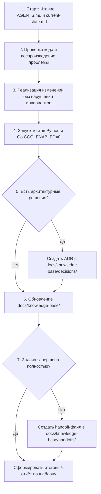

# AGENTS.md — Инструкции для ИИ-агентов и разработчиков

> **Статус документа:** Актуален  
> **Дата последней проверки:** 2026-10-15  
> **Применимость:** Ветка `test`, репозиторий Swipies RAGFlow (`D:/ragflow/swipies_25/ragflow`)

---

## 1. Введение и назначение

Этот файл является единой точкой входа (Single Source of Truth) для любого автономного ИИ-агента (Antigravity, Cursor, Claude Code, Windsurf, GitHub Copilot Workspace, Aider и др.) и инженера, приступающего к работе в репозитории.

Репозиторий представляет собой форк платформы RAGFlow (upstream v0.27.2) с масштабными доработками Swipies:
1. Защита конфиденциальных данных и криптографическое ядро AES-256-GCM ([`api/utils/key_crypto.py`](api/utils/key_crypto.py), [`internal/utility/crypto.go`](internal/utility/crypto.go)).
2. Изолированный CRM-модуль (amoCRM, Bitrix24, 1С:Предприятие, HubSpot) с гарантированной доставкой через Outbox-паттерн ([`api/crm/`](api/crm/), [`agent/tools/`](agent/tools/), [`rag/svr/crm_outbox_worker.py`](rag/svr/crm_outbox_worker.py)).
3. Рекламный движок (Swipies Ads Engine) и система спонсорских интеграций ([`api/apps/ad_app.py`](api/apps/ad_app.py), [`api/db/services/ad_engine_service.py`](api/db/services/ad_engine_service.py)).
4. Биллинг, платежи (Atmos Gateway) и многоуровневая система лицензирования ([`api/apps/payment_app.py`](api/apps/payment_app.py), [`api/apps/restful_apis/license_api.py`](api/apps/restful_apis/license_api.py)).

---

## 2. Что прочитать перед началом любой задачи (Mandatory Reading)

Перед внесением любых изменений агент ОБЯЗАН последовательно ознакомиться со следующими материалами:

1. Настоящий файл [`AGENTS.md`](AGENTS.md).
2. Оглавление базы знаний: [`docs/knowledge-base/README.md`](docs/knowledge-base/README.md).
3. Текущее подтверждённое состояние системы: [`docs/knowledge-base/current-state.md`](docs/knowledge-base/current-state.md).
4. Архитектурная карта и границы подсистем: [`docs/knowledge-base/architecture.md`](docs/knowledge-base/architecture.md).
5. Документ по конкретной подсистеме, которую затрагивает задача:
   - При работе с коннекторами и шифрованием: [`docs/knowledge-base/decisions/ADR-001-connector-cryptography-fail-closed.md`](docs/knowledge-base/decisions/ADR-001-connector-cryptography-fail-closed.md) и [`test/test_connector_security.py`](test/test_connector_security.py).
   - При работе с CRM: [`specs/003-crm-v1-integration/spec.md`](specs/003-crm-v1-integration/spec.md) и [`docs/knowledge-base/decisions/ADR-002-crm-subsystem-isolation.md`](docs/knowledge-base/decisions/ADR-002-crm-subsystem-isolation.md).
   - При работе с рекламой: [`docs/knowledge-base/decisions/ADR-003-ads-subsystem-decoupling.md`](docs/knowledge-base/decisions/ADR-003-ads-subsystem-decoupling.md).
   - При наличии незавершённой работы предшественников: каталог [`docs/knowledge-base/handoffs/`](docs/knowledge-base/handoffs/).

---

## 3. Непреложные правила работы (Core Invariants)

1. **Запрет деструктивных действий в Git:**
   - Команды `git push`, автоматический деплой и флаг `--apply` для боевых баз данных **СТРОГО ЗАПРЕЩЕНЫ**, если нет явного прямого указания владельца репозитория.
   - Любая миграция данных по умолчанию запускается в режиме `--dry-run`.
2. **Конфиденциальность и Zero Secrets Leak:**
   - **НИКОГДА** не выводить значения секретов, токенов, API-ключей, мастер-паролей и 64-символьных hex-строк в логи, консоль или файлы документации. Все значения в отчётах должны быть маскированы: `3113...bbd` или `<REDACTED>`.
   - Файлы `.env` и секретные переменные окружения не коммитятся.
3. **Авторство коммитов:**
   - Все коммиты должны сохранять реального автора проекта:
     `git config user.name "Sardor"`
     `git config user.email "albakiev.sardorbek@gmail.com"`
   - Запрещено подменять автора на системные имена ИИ («Antigravity», «AI Assistant» и т.п.).
4. **Сохранение существующей структуры и обратной совместимости:**
   - Не перемещать и не переименовывать существующие файлы ядра, если это может сломать внешние ссылки или сборку.
   - Сохранять формат шифрования `enc:v2:` (AES-256-GCM) для новых данных и обеспечивать прозрачное чтение `enc:v1:` (legacy CTR/HMAC).
5. **Физическая изоляция подсистем:**
   - CRM-код (`api/crm/`, `api/db/crm_models.py`, `agent/tools/crm/`) **не должен импортировать** рекламные модули (`ad_engine_service`, `ad_policy_service`, `ad_app`).

---

## 4. Команды проверки качества и тестов

Перед передачей задачи агент обязан выполнить соответствующие тесты и предоставить реальный вывод терминала:

### 4.1. Проверка безопасности коннекторов и шифрования (Python)
```bash
python -m unittest test.test_connector_security
```
*Ожидаемый результат:* 15 тестов завершаются со статусом `OK`, включая мутационный тест маскирования.

### 4.2. Проверка CRM-подсистемы (Python)
```bash
# Базовый контракт и лицензионный гейт
python -m unittest test.test_crm_foundations

# Адаптер amoCRM и ротация токенов
python -m unittest test.test_crm_amocrm

# Адаптер Bitrix24 и SSRF-защита
python -m unittest test.test_crm_bitrix24

# 1С:Предприятие (OData остатки)
python -m unittest test.test_crm_1c

# Инструменты агента и Outbox воркер
python -m unittest test.test_crm_tool_and_outbox
```

### 4.3. Проверка сборки и тестов Go
> **Важно:** В связи с зависимостями от CGO-библиотек парсеров DeepDoc (`office_oxide.h`, `pdfium`), typecheck и юнит-тесты Go выполняются с отключенным CGO (`CGO_ENABLED=0`), что активирует нативные no-cgo заглушки:

```bash
# Typecheck сервисов, хэндлеров и синкера
wsl bash -c "CGO_ENABLED=0 go build -gcflags=-e ./internal/service/... ./internal/handler/... ./internal/syncer/..."

# Тесты криптографии в Go
wsl bash -c "go test -count=1 -v -run TestCrypto ./internal/utility/..."

# Тест маскирования учетных данных в Go Handler
wsl bash -c "CGO_ENABLED=0 go test -v -run TestConnectorHandler_CredentialMaskingRealHandler ./internal/handler/..."
```

---

## 5. Процесс работы и порядок обновления базы знаний

Агенты обязаны следовать регламенту:



1. **Документирование вместе с кодом:** Изменения в коде и документации оформляются в рамках одного коммита / PR.
2. **Фиксация архитектурных решений:** Любое нетривиальное решение (выбор протокола, добавление таблицы, изменение схемы аутентификации) оформляется как ADR в каталоге [`docs/knowledge-base/decisions/`](docs/knowledge-base/decisions/) по шаблону [`docs/knowledge-base/templates/decision-template.md`](docs/knowledge-base/templates/decision-template.md).
3. **Фиксация незавершённой работы:** Если контекст агента исчерпан или задача прервана, создаётся файл передачи в [`docs/knowledge-base/handoffs/`](docs/knowledge-base/handoffs/) с указанием ветки, коммита, проверенных гипотез и следующих шагов.

---

## 6. Подключение инструкций в различных ИИ-инструментах

Разные инструменты разработки требуют явного указания на данный файл:

* **Antigravity CLI / Agent:** Автоматически подхватывает контекст при обращении к рабочей директории. В первом запросе рекомендуется передавать:
  > *"Прочитай AGENTS.md и docs/knowledge-base/current-state.md перед выполнением задачи."*
* **Cursor IDE:**
  - Добавьте ссылку в `.cursorrules` или в системный промпт:
    `Always refer to AGENTS.md and docs/knowledge-base/ for project guidelines and verification commands.`
* **Claude Code CLI:**
  - Добавьте в файл `CLAUDE.md` ссылку: `@AGENTS.md`.
* **Windsurf (Cascade):**
  - Добавьте в `.windsurfrules` директиву следовать `AGENTS.md`.
* **GitHub Copilot / Copilot Workspace:**
  - Ссылайтесь на `AGENTS.md` в описании задачи или PR.

---

## 7. Контрольный чек-лист перед завершением сессии

- [ ] Код соответствует принципам наименьших привилегий (Least Privilege).
- [ ] Никакие секретные данные не утекли в логи и markdown-файлы.
- [ ] Относительные ссылки в созданных/изменённых документах проверены.
- [ ] Запущены обязательные юнит-тесты (Python / Go), подтверждён код выхода 0.
- [ ] Обновлены затронутые страницы базы знаний в `docs/knowledge-base/`.
- [ ] Если работа прервана — составлен handoff-файл в `docs/knowledge-base/handoffs/`.
