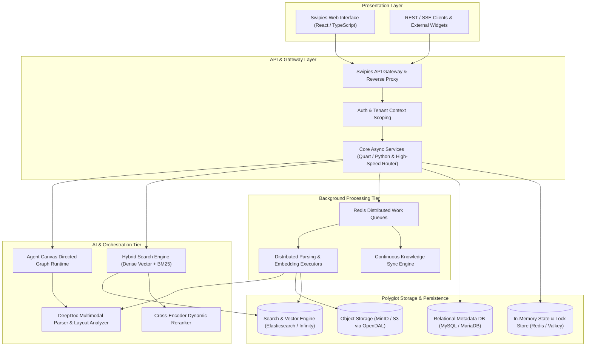
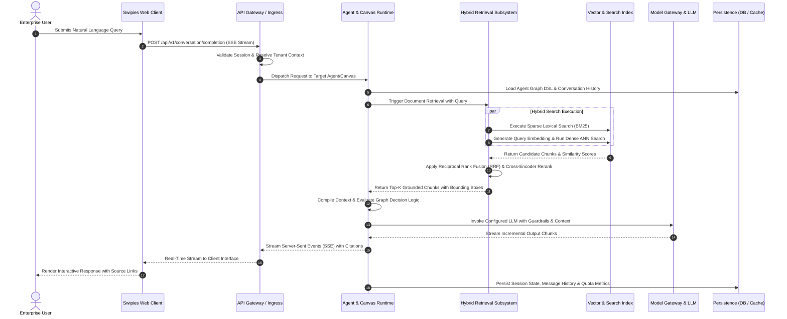
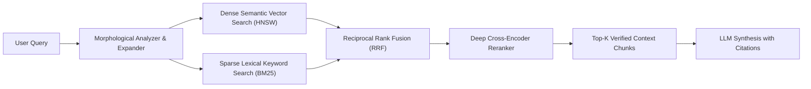
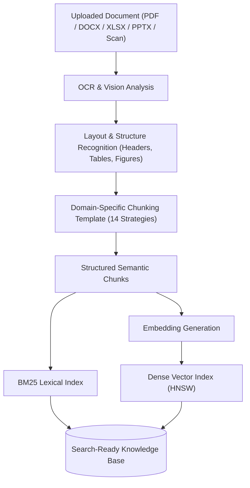
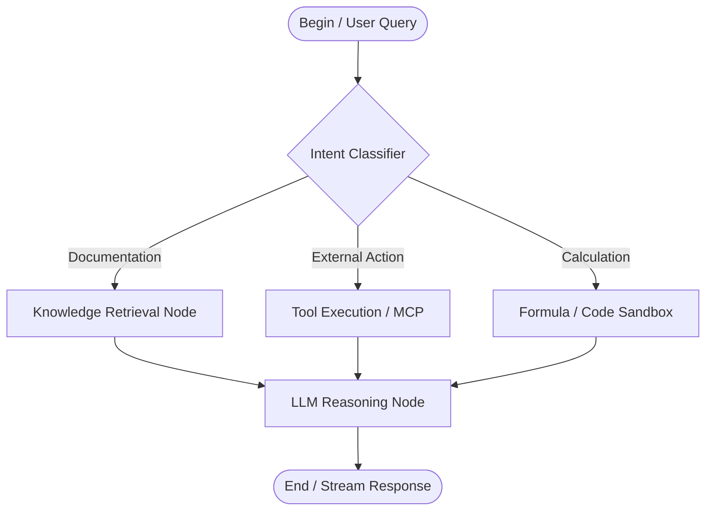
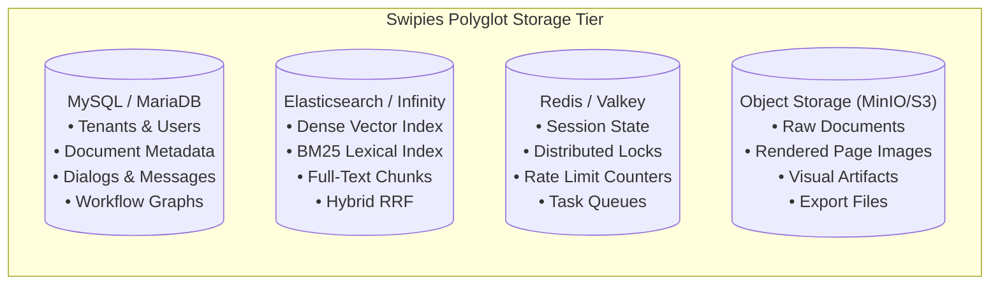
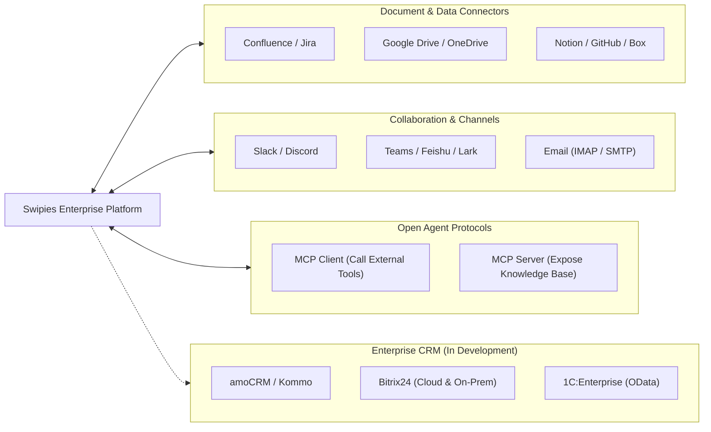
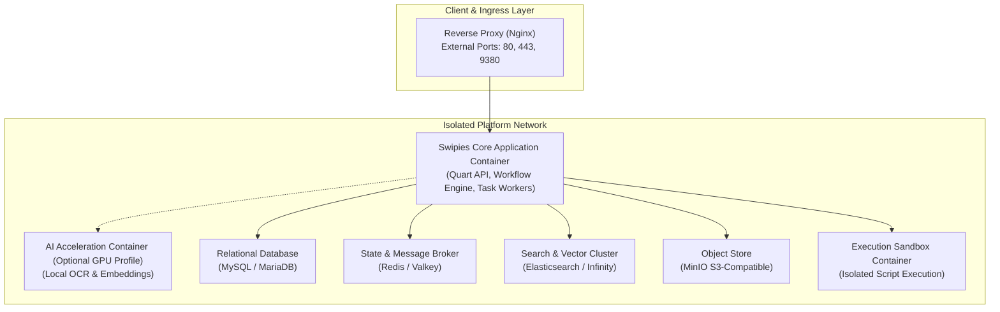

# Swipies Enterprise Platform Architecture Specification

---

## 1. Executive Summary & Platform Overview

### 1.1 What is Swipies?
**Swipies** is an enterprise-grade, modular Artificial Intelligence and Retrieval-Augmented Generation (RAG) platform. It unifies deep multimodal document understanding, hybrid vector/lexical retrieval, autonomous agent orchestration, and enterprise system connectivity into an integrated, secure, multi-tenant software system.

Swipies is engineered to bridge raw unstructured organizational knowledge (documents, spreadsheets, presentations, codebases, enterprise wikis, and databases) with intelligent LLM-driven applications. Rather than treating document processing as generic text extraction, Swipies incorporates deep vision-based document layout analysis, domain-specific chunking templates, fine-grained semantic embedding, and cross-encoder reranking to eliminate AI hallucinations and deliver grounded, fully-cited answers.

### 1.2 Core Platform Capabilities
- **Deep Multimodal Document Understanding**: Vision-driven document parsing with layout recognition, OCR, table structure recovery, and figure captioning across PDFs, Office documents, scans, web pages, and structured data formats.
- **Intelligent Knowledge Base Management**: Specialized, domain-tailored chunking strategies (e.g., standard text, question-answering pairs, resumes, legal contracts, scientific papers, tabular data, presentations, and books).
- **Hybrid Search & Fusion Engine**: Dense semantic vector similarity combined with sparse lexical search (BM25) and cross-encoder reranking to ensure high precision and recall.
- **Visual Agent Workflow Orchestration**: A drag-and-drop agent canvas supporting deterministic workflow routing, condition branches, tool execution, iterative loops, and stateful memory.
- **Pluggable Model Gateway**: Unified connectivity to dozens of proprietary and open-source Large Language Models, dense embedding providers, rerankers, vision models, and speech engines.
- **Model Policies & AI Resource Governance**: Fine-grained quota management, tenant-specific model routing, rate limits, and run-time resource usage accounting.
- **Extensible Integration Subsystem**: Native connectors to third-party enterprise tools, data sources, chat channels, and Model Context Protocol (MCP) servers. Enterprise CRM integrations are currently in development.
- **Zero-Trust Enterprise Multi-Tenancy**: Complete tenant isolation, granular role-based access control (RBAC), end-to-end cryptographic encryption at rest (AES-256-GCM), and anti-SSRF network egress security.

### 1.3 System Mission & Enterprise Value
Swipies serves as the cognitive intelligence backbone for organizations requiring secure, on-premise or private cloud deployment of AI agents. By offering truthful question-answering backed by verifiable source citations and autonomous tool-augmented workflows, Swipies reduces knowledge discovery time, automates complex enterprise workflows, and ensures complete enterprise data sovereignty.

---

## 2. High-Level System Architecture

Swipies adopts a decoupled, multi-tier microservices architecture designed for high throughput, horizontal scalability, and operational fault tolerance.

### 2.1 Architectural Tiers
1. **Presentation Layer (Frontend)**: Modern Single Page Application (SPA) built on React 18, TypeScript, and Tailwind CSS, providing responsive interfaces for document management, dataset curation, agent workflow creation, knowledge retrieval testing, and platform administration.
2. **API & Gateway Layer (Backend)**: Asynchronous REST and Server-Sent Events (SSE) gateway handling user authentication, tenant scoping, request validation, API key management, and routing.
3. **AI & Retrieval Engine**: Houses proprietary algorithms for OCR, layout recognition, domain-specific text chunking, hybrid semantic retrieval, query reformulation, and LLM context compilation.
4. **Agent Orchestration Subsystem**: Graph-based execution runtime executing visual canvases, decision nodes, dynamic API tools, and multi-turn conversational agents.
5. **Background Processing & Workers**: Decoupled asynchronous worker nodes consuming parsing, OCR, indexing, and data synchronization tasks from distributed task queues.
6. **Data & Storage Tier**: Polyglot persistence combining relational metadata storage, search/vector engines, distributed in-memory cache, and high-performance object storage.

---

## 3. Component Interaction & End-to-End Data Flow

The following sequence illustrates the complete life cycle of an enterprise inquiry through Swipies:

### 3.1 Step-by-Step Execution Journey
1. **Client Submission**: The end user submits a conversational query or interacts with a visual agent widget.
2. **Gateway Ingress**: The API Gateway intercepts the request, verifies authentication (session or API key), enforces tenant rate limits, and binds the request to the tenant ID.
3. **Agent State Resolution**: The agent runtime retrieves the conversation state from Redis and loads the visual workflow execution graph from MySQL.
4. **Hybrid Retrieval**:
   - The query undergoes morphological segmentation and semantic expansion.
   - Dense vector retrieval executes approximate nearest neighbor (ANN) search against document embeddings.
   - Sparse lexical search executes BM25 matching for exact terms, names, and numerical identifiers.
   - Reciprocal Rank Fusion (RRF) merges candidate lists, which are subsequently re-scored by a deep cross-encoder reranking model.
5. **Context Compilation**: The top-ranked chunks, document citations, and user conversation history are formatted into an optimized context window.
6. **Model Invocation & Streaming**: The request is dispatched via the Model Gateway to the tenant's chosen LLM. Response chunks are streamed back via Server-Sent Events (SSE).
7. **Citation Tracking & Quota Accounting**: Each generated segment is cross-referenced with source document IDs, pages, and bounding boxes. Quota consumption and execution metrics are logged atomically for tenant billing.

---

## 4. AI & Retrieval Engine

At the heart of Swipies is an advanced retrieval pipeline designed for high precision across enterprise knowledge domains.

### 4.1 Dense Vector Retrieval
- Supports multi-dimensional embeddings (e.g., 384, 768, 1024, 1536 dimensions).
- Compatible with all major embedding providers (OpenAI, Voyage, BAAI/BGE, Cohere, Jina, HuggingFace, local Ollama models).
- Stores vectors in optimized HNSW indices with cosine or inner-product similarity metrics.

### 4.2 Sparse Lexical Search
- Leverages BM25 indexation with domain-specific segmentation, term-frequency weighting, and morphological analysis for exact keyword and identifier matching.
- Ensures accurate retrieval of technical codes, part numbers, SKU codes, and legal citations.

### 4.3 Two-Stage Cross-Encoder Reranking
- Candidate chunks from dense and sparse retrieval are merged via Reciprocal Rank Fusion (RRF).
- A second-stage cross-encoder reranker scores the concatenated `(query, document_chunk)` pairs, re-evaluating true semantic relevance and filtering out false positives.

### 4.4 AI Resource Policies, Quotas & Model Governance
- **Tenant Quotas**: Administrators configure monthly usage budgets, concurrent request caps, and allowed model lists per organization.
- **Dynamic Model Fallback**: If an external AI provider encounters transient rate limits or outages, the platform gracefully switches to configured secondary models.
- **Usage Metrics**: Granular accounting records input/output volume, model latency, and execution duration per tenant, providing complete transparency for enterprise chargeback.

---

## 5. Document Processing & Ingestion Pipeline (DeepDoc)

Swipies does not rely on naive plaintext extraction. Instead, it utilizes **DeepDoc**, an intelligent multimodal processing engine.

### 5.1 DeepDoc Vision Architecture
- **Layout Recognition**: Identifies page headers, footers, section titles, paragraphs, tables, images, and footnotes.
- **Table Structure Recovery**: Reconstructs nested tables, merged cells, and headers into structured formats (HTML/Markdown) rather than flattened text.
- **OCR Engine**: Extracts text from scanned PDFs, images, and low-quality documents with automatic language detection and rotation correction.

### 5.2 14 Domain-Specific Chunking Templates
Swipies provides 14 purpose-built chunking strategies tailored to distinct enterprise data types:
1. `naive`: Standard text chunks with configurable character limits and sliding window overlaps.
2. `qa`: Extracts question-answer pairs for direct FAQ compilation.
3. `table`: Preserves row-column relationships and cell context for financial spreadsheets and tabular reports.
4. `resume`: Parses resumes into structured segments (contact, experience, education, skills).
5. `manual`: Understands hierarchy in technical manuals and standard operating procedures.
6. `paper`: Tailored for academic and scientific publications with abstract, section, and reference recognition.
7. `book`: Chapter and section hierarchy parser for literature and lengthy manuals.
8. `laws`: Preserves legal article, section, and paragraph legal cross-referencing.
9. `presentation`: Extracts slide titles, bullet points, presenter notes, and visual layout from PPTX files.
10. `picture`: Generates visual embeddings and captions for images and diagrams.
11. `one`: Ingests entire small documents as single atomic reference units.
12. `knowledge_graph`: Extracts entities, relations, and triplets for structured graph construction.
13. `email`: Parses email headers, threads, and attachments into contextual conversations.
14. `tag`: Organizes chunks based on hierarchical organizational tags.

---

## 6. Visual Agent Canvas & Workflow Graph

Swipies features a drag-and-drop Visual Agent Canvas that enables enterprise teams to construct autonomous multi-step reasoning workflows without code.

### 6.1 Graph Execution Model
- Workflows are defined as Directed Acyclic Graphs (DAGs) serialized into JSON-based Domain Specific Languages (DSL).
- The runtime executor navigates nodes deterministically based on edge conditions, variable evaluation, and LLM classifications.
- Graphs maintain run-time resource usage accounting, variable scope isolation, and task checkpoints.

### 6.2 Standard Canvas Node Types
- **Begin Node**: Ingests user input, conversational parameters, and attachments.
- **Retrieval Node**: Queries configured knowledge bases using hybrid search and returns relevant context.
- **Reasoning Node (LLM)**: Executes prompt templates, system instructions, and structured output formatting.
- **Condition Node**: Evaluates logical expressions to branch workflow execution.
- **Categorize Node**: Uses few-shot semantic classification to direct user intents.
- **Tool Execution Node**: Calls internal tools, Python scripts, or external APIs.
- **Iteration / Loop Node**: Executes batch operations over lists or arrays.
- **MCP Node**: Delegates complex external operations to Model Context Protocol servers.

### 6.3 Team Collaboration & Tenant Scoping
In collaborative team environments, canvas workflows created by a workspace owner can be executed by team members. The agent runtime scopes tool lookups and external server verification to the canvas owner while preserving the caller's audit trail, preventing cross-tenant privilege escalation (`agent/canvas.py:350-362`, `agent/component/agent_with_tools.py:110-116`, `api/apps/restful_apis/agent_api.py:370-385`).

---

## 7. Polyglot Persistence Architecture

Swipies leverages specialized data stores to optimize performance across different data structures:

### 7.1 Relational Database (MySQL / MariaDB)
- Stores structural enterprise metadata: tenants, organizations, user accounts, role definitions, and knowledge base configurations.
- Manages conversational dialog sessions, version histories, and workflow canvas definitions.
- All entities enforce non-nullable tenant identification for strict multi-tenant isolation (`api/db/db_models.py:Tenant`, `api/db/db_models.py:UserCanvas:527`).

### 7.2 Search & Vector Storage (Elasticsearch / Infinity / OpenSearch)
- Hosts high-performance dense vector indices (HNSW) and inverted BM25 indices.
- Performs real-time full-text search, semantic vector filtering, and hybrid score fusion.

### 7.3 Distributed Cache & In-Memory Store (Redis / Valkey)
- Manages transient conversation state, conversational history caches, and active user sessions.
- Houses distributed task queues consumed by background document processing workers.
- Enforces distributed mutual exclusion (locks) and centralized API rate limiting.

### 7.4 Object Storage (OpenDAL Abstraction Layer)
- Manages unstructured files: uploaded PDFs, Office documents, extracted page images, and export packages.
- Integrated via Apache OpenDAL, providing seamless abstraction across local file systems, MinIO, Amazon S3, Google Cloud Storage, and Azure Blob Storage without code changes.

---

## 8. Enterprise Security & Multi-Tenancy

Swipies is built on zero-trust principles to meet the security requirements of enterprise IT organizations.

### 8.1 Zero-Trust Multi-Tenancy
- Every primary database entity enforces strict, non-nullable tenant scoping (`api/db/db_models.py:UserCanvas:527`, `api/db/db_models.py:Knowledgebase`).
- All REST API endpoints enforce programmatic tenant validation via decorators, preventing horizontal privilege escalation or unauthorized cross-tenant data access (`api/apps/__init__.py:login_required`, `api/apps/restful_apis/agent_api.py:38-40`).

### 8.2 Cryptographic Key Management & Data Protection
- **AES-256-GCM Encryption**: Third-party API credentials, database credentials, OAuth session keys, and webhook endpoints are encrypted at rest using AES-256-GCM, derived via HKDF-SHA256 from the platform's managed master key (`api/utils/key_crypto.py:37-65`, `ENC_V2_PREFIX`).
- **Fail-Closed Key Validation**: If the platform encryption key is missing or unconfigured, the platform refuses to start, preventing unencrypted data operations (`common/settings.py:126-135`, `api/utils/key_crypto.py:68-80`).
- **Dynamic Masking**: API endpoints automatically redact confidential credentials and phone numbers before returning payloads to frontend clients or writing to system logs (`api/utils/key_crypto.py:165-175`).

### 8.3 Network Egress Security & Anti-SSRF Guard
- All outbound HTTP requests initiated by tools, web crawlers, or webhook adapters are routed through a hardened custom transport layer (`common/ssrf_guard.py:24-95`).
- **SSRF Prevention**: Resolves target hostnames and enforces strict IP validation, blocking loopback addresses, cloud metadata services, and internal private subnets unless explicitly allowlisted by system administrators (`common/ssrf_guard.py:24-95`).
- **DNS-Pinning & No Redirects**: Employs socket-level DNS pinning to defeat DNS-rebinding attacks, and enforces direct connections without redirects to prevent open-redirect bypasses (`common/ssrf_guard.py:102-120`).

### 8.4 Code Execution Sandboxing
- Dynamic Python or script execution invoked by agent tools is isolated within containerized sandboxes with restricted network access, memory caps, execution timeouts, and dropped privileges (`docker/docker-compose-base.yml:128-142`, `agent/tools/code_exec.py:28-60`, `agent/sandbox/executor_manager/services/execution.py:30-85`).

---

## 9. Integrations & External Connectivity

Swipies provides enterprise connectivity across workplace systems, storage repositories, and autonomous communication protocols.

### 9.1 Data Connectors & Ingestion Sources
- **Enterprise Storage & Knowledge**: GitHub, Jira, Confluence, Notion, Google Drive, Microsoft OneDrive, Box, S3, MinIO.
- **Collaboration & Messaging**: Lark/Feishu, Discord, Slack, WeChat, Email (IMAP/SMTP).
- **Web Scraping & Public Crawlers**: Built-in async web crawlers with robots.txt adherence, JavaScript rendering, and dynamic sitemap exploration.

### 9.2 Enterprise CRM & Transaction Subsystems (In Development / В разработке)
Enterprise CRM integration capabilities are currently in active development to deliver secure, automated synchronization between conversational agents and enterprise transactional backends:
- **amoCRM / Kommo (In Development)**: Lead generation and contact ingestion via REST API with automated session renewal and distributed locking.
- **Bitrix24 Cloud & On-Premise (In Development)**: Inbound webhook lead ingestion with credential masking, regional domain boundary validation, and centralized rate limiting.
- **1C:Enterprise (In Development)**: Read-only inventory balance and product catalog queries over standard OData REST protocols with private network allowlisting.

### 9.3 Model Context Protocol (MCP) Support
Swipies incorporates native support for Anthropic's Model Context Protocol (MCP):
- **MCP Client**: Canvas agents connect dynamically to external MCP servers over Standard I/O (stdio) or Server-Sent Events (SSE), dynamically expanding agent capabilities.
- **MCP Server**: Swipies can expose its own curated knowledge bases as a standard MCP server, allowing external coding assistants and AI agents to query Swipies documents directly.

---

## 10. Infrastructure, Deployment & Container Topology

Swipies is container-native, supporting rapid deployment via Docker Compose or enterprise Kubernetes clusters (Helm).

### 10.1 Production Container Roles
- **Application Server (`swipies-cpu` / `swipies-gpu`)**: Core server running the Quart API, agent runtime, task executors, and deep document parsing pipeline. GPU profiles leverage CUDA acceleration for high-throughput OCR and local model inference.
- **Relational Store (`swipies-mysql`)**: Relational metadata database configured with connection pooling, UTF8MB4 support, and automated schema verification.
- **Cache & Queue Broker (`swipies-redis`)**: In-memory state and messaging broker running Valkey/Redis for caching, distributed locking, and rate limiting.
- **Search & Vector Engine (`swipies-es01` / `swipies-infinity`)**: Distributed search and vector indexing cluster.
- **Object Storage (`swipies-minio`)**: S3-compliant object store hosting raw files, chunks, and visual debug artifacts.
- **Code Sandbox (`swipies-sandbox-executor-manager`)**: Hardened container environment for executing arbitrary user-defined code.

### 10.2 Networking & Port Exposure
By default, backing databases and cache layers bind strictly to the private internal bridge network. Only the reverse proxy HTTP/HTTPS ports (default: 80, 443, 9380) are exposed externally to clients.

---

## 11. Scalability, Concurrency & Performance Engineering

Swipies is engineered to handle enterprise workloads with hundreds of thousands of documents and concurrent conversational sessions.

### 11.1 Horizontal Worker Scaling
- **Stateless API Gateway**: The API and Canvas runtime servers are completely stateless (`api/db/services/canvas_service.py:360-415`). User requests can be load-balanced across multiple container instances using standard round-robin or least-connection algorithms.
- **Asynchronous Task Workers**: Document parsing, OCR, and embedding generation are decoupled from web request threads. Tasks are pushed to persistent queues in MySQL and Redis, where worker nodes pull jobs according to available CPU and GPU capacity (`rag/svr/task_executor.py:60-120`, `docker/launch_backend_service.sh:45`).

### 11.2 High-Throughput Retrieval Optimization
- **Hybrid Vector & Lexical Retrieval**: The search subsystem combines dense vector similarity matching with BM25/keyword scoring (`rag/nlp/search.py:45-85`, `internal/service/nlp/reranker.go`), followed by neural cross-encoder reranking (`rag/llm/rerank_model.py:34-60`) to filter and reorder candidate chunks based on semantic relevance.
- **Index Namespacing & Query Caching**: Document collections are isolated by tenant/knowledge-base ID namespaces (`rag/nlp/search.py:46-47`), while an in-memory document existence cache (`_doc_exists_cache`, `rag/nlp/search.py:50-115`) eliminates redundant database lookups during concurrent fan-out and ReAct agent workflows.

### 11.3 Concurrency Control & State Management
- **Distributed Mutex (RedLock)**: Critical state transitions—such as session renewals and document chunking task assignment—use Redis distributed locks with Lua-scripted ownership release (`common/misc_utils.py:245-270`).
- **Optimistic Concurrency & Fencing Counters**: Key records enforce monotonic version counters (`entity_version`), ensuring concurrent workers detect conflicting updates and fail safe without overwriting newer state (`api/db/db_models.py`, `specs/003-crm-v1-integration/spec.md`).
- **Database Connection Pooling**: Peewee ORM manages pooled database connections with automatic idle recycling, preventing connection exhaustion under traffic spikes (`api/db/db_models.py:45-70`).

---

## 12. Summary & Conclusion

The **Swipies** platform delivers an enterprise-ready foundation for AI transformation. By coupling proprietary computer vision document intelligence with hybrid neural/lexical retrieval, fine-grained multi-tenancy, and visual agent orchestration, Swipies eliminates the common vulnerabilities, hallucinations, and data governance issues associated with standard RAG implementations. Its modular architecture ensures high availability, horizontal scalability, and seamless integration into modern enterprise private cloud and on-premise infrastructure.
