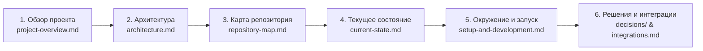

# База знаний Swipies RAGFlow

> **Статус документа:** Актуален  
> **Дата последней проверки:** 2026-10-15  
> **Основная ветка разработки:** `test`  
> **Базовый релиз:** upstream RAGFlow `v0.27.2` (commit `a024bea0c`)

Добро пожаловать в инженерную базу знаний проекта **Swipies RAGFlow**. Этот каталог предназначен для онбординга инженеров и автономных ИИ-агентов. Все документы содержат подтверждённую информацию из кода, конфигураций и истории Git-коммитов.

---

## 🗺️ Маршрут чтения для нового участника (Reading Path)

Чтобы максимально быстро включиться в проект и не допустить архитектурных регрессий, рекомендуется следующий порядок изучения:



1. **[Назначение и границы проекта](project-overview.md)** (`project-overview.md`): Что такое Swipies, какие задачи решает, где заканчиваются границы системы и чем отличается от upstream RAGFlow.
2. **[Архитектура платформы](architecture.md)** (`architecture.md`): Системные уровни, потоки данных (RAG, Canvas, CRM Outbox, Ads), внешние сервисы и хранилища.
3. **[Карта репозитория](repository-map.md)** (`repository-map.md`): Назначение папок `api/`, `agent/`, `common/`, `internal/`, `rag/`, `web/` и ключевые файлы-точки входа.
4. **[Текущее состояние системы](current-state.md)** (`current-state.md`): Что работает стабильно, что находится в разработке, подтверждённые ограничения.
5. **[Локальная разработка и тестирование](setup-and-development.md)** (`setup-and-development.md`): Инструкции по запуску backend/frontend, настройки переменных окружения, команды валидации и тестов.
6. **[Интеграции](integrations.md)** (`integrations.md`): Внешние CRM (amoCRM, Bitrix24, 1С, HubSpot), хранилища, платежный шлюз Atmos, провайдеры моделей.
7. **[Реестр архитектурных решений (ADR)](decisions/README.md)** (`decisions/`): Почему система спроектирована именно так (криптография коннекторов, изоляция CRM, отказ от Go в бизнес-логике).
8. **[История выполненных работ](work-history.md)** (`work-history.md`): Хроника ключевых коммитов и вех проекта.
9. **[Известные ошибки и технический долг](known-issues.md)** (`known-issues.md`): Ошибки компиляции Go в upstream, открытые проблемы и способы обхода.
10. **[Планы и Roadmap](roadmap.md)** (`roadmap.md`): Ближайшие запланированные задачи.
11. **[Развертывание и CI/CD](deployment.md)** (`deployment.md`): Docker-образы, compose-файлы, GitHub Actions пайплайны.

---

## 📁 Структура каталога базы знаний

```text
docs/knowledge-base/
├── README.md                      # Настоящее оглавление и маршрут чтения
├── project-overview.md            # Концепция, миссия, возможности и границы
├── architecture.md                # Схемы компонентов, потоки данных, безопасность
├── repository-map.md              # Карта каталогов и ключевых модулей
├── setup-and-development.md       # Развёртывание, зависимости, запуск, тесты
├── current-state.md               # Статус реализации фичей, ограничения
├── work-history.md                # Подтверждённая история изменений и коммитов
├── roadmap.md                     # Ближайшие планы и вехи развития
├── known-issues.md                # Баги upstream, техдолг, способы воспроизведения
├── integrations.md                # Внешние системы, протоколы, креды без секретов
├── deployment.md                  # Docker-сборки, деплой, скрипты запуска
├── decisions/                     # Architecture Decision Records (ADR)
│   ├── README.md                  # Реестр решений
│   ├── ADR-001-connector-cryptography-fail-closed.md
│   ├── ADR-002-crm-subsystem-isolation.md
│   ├── ADR-003-ads-subsystem-decoupling.md
│   └── ADR-004-python-over-go-for-business-modules.md
├── handoffs/                      # Передача контекста между агентами
│   ├── README.md                  # Регламент передачи задач
│   └── 2026-10-15-crm-and-knowledge-base-handoff.md
└── templates/                     # Стандартные шаблоны документов
    ├── decision-template.md       # Шаблон ADR
    ├── task-report-template.md    # Шаблон отчёта о работе
    └── handoff-template.md        # Шаблон передачи контекста
```

---

## ⚡ Правила для авторов документации

- Любое утверждение должно ссылаться на исходный файл или коммит: например, [`api/utils/key_crypto.py`](../../api/utils/key_crypto.py).
- Все даты проверок фиксируются в формате ISO (например, `2026-10-15`).
- Значения секретов, паролей и токенов категорически запрещены.
- Документация обновляется одновременно с кодом в одном коммите / PR.
