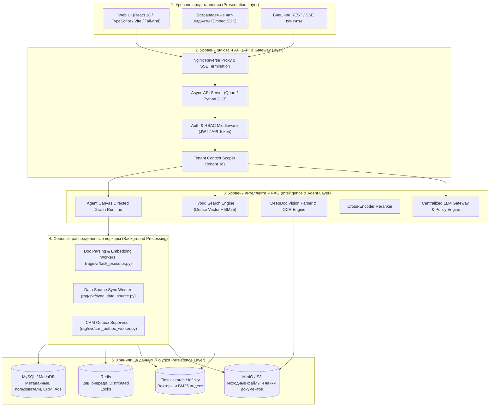
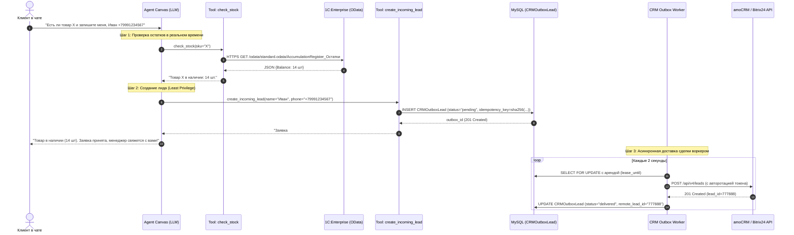
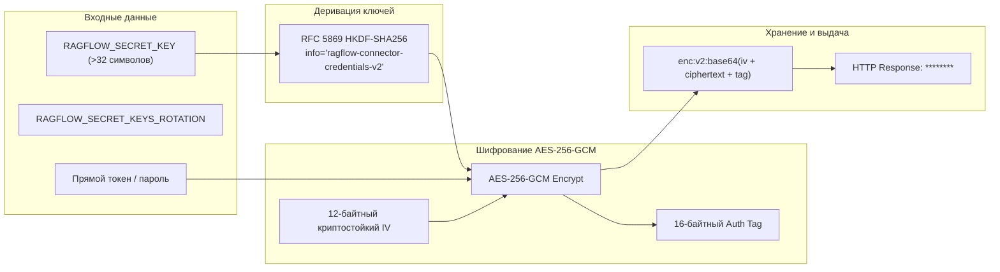

# Архитектура платформы Swipies (Architecture Specification)

> **Статус документа:** Актуален  
> **Дата последней проверки:** 2026-10-15  
> **Первоисточники:** [`SWIPIES_ARCHITECTURE.md`](../../SWIPIES_ARCHITECTURE.md), [`specs/003-crm-v1-integration/spec.md`](../../specs/003-crm-v1-integration/spec.md), [`api/ragflow_server.py`](../../api/ragflow_server.py)

---

## 1. Системная архитектура (System Topology)

Платформа Swipies построена на принципах микросервисной и модульной архитектуры, разделенной на пять функциональных уровней:

---

## 2. Подсистемы и их взаимодействие

### 2.1. Ядро RAG (DeepDoc + Retrieval)
1. **Загрузка и парсинг:** Документ загружается в MinIO/S3, создаётся задача в очереди Redis.
2. **Экзекутор (`rag/svr/task_executor.py`):** Забирает задачу, пропускает через OCR/Layout анализатор DeepDoc, нарезает на чанки по правилам выбранного парсера.
3. **Эмбеддинг и индексация:** Текст чанка отправляется в embedding-модель, dense-вектор и текст сохраняются в Infinity или Elasticsearch.
4. **Поиск (Query Phase):** Запрос пользователя обогащается через эмбеддинг, выполняется параллельный dense + sparse поиск, результаты объединяются через RRF (Reciprocal Rank Fusion) и переранжируются через Cross-Encoder.

### 2.2. Агентский рантайм (Agent Canvas)
- Описан в [`agent/canvas.py`](../../agent/canvas.py) и [`agent/component/`](../../agent/component/).
- Граф исполнения состоит из узлов:
  - `Begin`: точка входа (чат, вебхук, триггер).
  - `Agent` / `AgentWithTools` ([`agent/component/agent_with_tools.py`](../../agent/component/agent_with_tools.py)): LLM с привязанными инструментами function calling.
  - `Retrieval`: выборка из конкретных баз знаний.
  - `Switch`, `Loop`, `Iteration`: управляющие конструкции.
  - `Message`: форматирование ответа пользователю со ссылками на первоисточники.

---

## 3. Потоки данных CRM: Live-запрос и Outbox-запись

Для сценария работы с клиентом разработана двухконтурная схема: **синхронная проверка остатков** и **асинхронная гарантированная запись сделки через Outbox**.

---

## 4. Криптографическая модель коннекторов

Учётные данные внешних систем (Data Sources, CRM-коннекторы, токены AI-моделей) защищены криптографическим контуром:

* **Чтение устаревших данных (`enc:v1:`):** Поддерживается дешифрование легаси-полезных нагрузок через fallback HMAC/CTR.
* **Дефолтные ключи ротации:** Если ключ указан в `RAGFLOW_SECRET_KEYS_ROTATION`, он принимается **исключительно на чтение (decrypt-only)**. Попытка зашифровать новые данные дефолтным ключом жестко блокируется (fail-closed).
