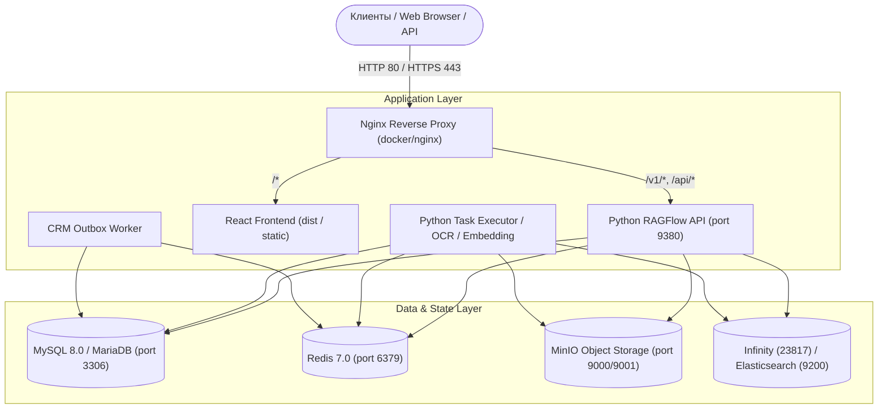

# Руководство по развертыванию и эксплуатации (Deployment & Operations Guide)

**Текущее состояние базы знаний:** актуально на **15 октября 2026 года**  
**Базовая ветка:** `test` (`a9b3e9f28`)  
**Базовый upstream:** `v0.27.2` (`a024bea0c`)

> [!CAUTION]
> **ПРАВИЛО РАЗРАБОТКИ И БЕЗОПАСНОСТИ:**
> В текущей рабочей сессии любые прямые вызовы `git push`, автоматический деплой, применение боевых миграций (`--apply`) и печать секретных ключей **СТРОГО ЗАПРЕЩЕНЫ**. Развертывание в продуктивный контур осуществляется только уполномоченным DevOps-инженером после ручного ревью.

---

## 1. Архитектура и топология развертывания

Платформа Swipies RAGFlow разворачивается в контейнеризированном окружении через Docker Compose либо Kubernetes.



---

## 2. Конфигурационные файлы Docker Compose

В каталоге `docker/` проекта содержатся готовые сценарии оркестрации:
- [docker/docker-compose.yml](../../docker/docker-compose.yml) — основной стек сервисов (API, UI, Nginx, Infinity, MySQL, Redis, MinIO).
- [docker/docker-compose-base.yml](../../docker/docker-compose-base.yml) — минимальный базовый стек инфраструктуры для локальной разработки.
- `docker/docker-compose-gpu.yml` — профиль запуска с поддержкой аппаратного ускорения NVIDIA CUDA для локальных моделей OCR/LLM.
- `docker/docker-compose-cpu.yml` — оптимизированный профиль для работы на стандартных CPU без дискретных видеокарт.

---

## 3. Настройка переменных окружения (Environment Configuration)

Перед запуском контейнеров необходимо скопировать безопасный шаблон конфигурации:
```bash
cp docker/.env.example docker/.env
```

### Критически важные параметры безопасности:
1. `RAGFLOW_SECRET_KEY`:
   - Основной 256-битный мастер-ключ шифрования.
   - **Генерация:** `openssl rand -hex 32` (строго 64 hex-символа или 32 байта).
   - При пустом ключе или попытке использовать дефолтный ключ upstream (`ragflow_single_global...`) запуск сервера будет заблокирован (Fail-Closed).
2. `RAGFLOW_SECRET_KEYS_ROTATION`:
   - Список старых/исторических ключей через запятую для расшифрования ранее сохраненных данных:
   - `RAGFLOW_SECRET_KEYS_ROTATION=<old_key_1>,<old_key_2>`
3. `MYSQL_PASSWORD`:
   - Пароль учетной записи пользователя MySQL базы данных.
4. `MINIO_SECRET_KEY`:
   - Секретный ключ для доступа к MinIO S3-хранилищу.

---

## 4. Порядок ручного развертывания (Production Runbook)

### Шаг 1. Предварительная проверка окружения
- Убедиться, что на целевом сервере установлены `docker` (>= 24.0) и `docker compose` (>= 2.20).
- Проверить наличие свободного места на диске (минимум 30 ГБ под Docker-образы и векторные индексы).
- Проверить доступность необходимых портов: `80`, `443`, `9380` (внутренний), `3306`, `6379`.

### Шаг 2. Запуск инфраструктурного слоя
```bash
cd docker
docker compose up -d mysql redis minio infinity
```
- Дождаться прохождения Healthcheck'ов базы данных:
  ```bash
  docker compose ps
  ```

### Шаг 3. Инициализация и миграции базы данных
- При первичном запуске база данных автоматически инициализируется скриптами `docker/init.sql`.
- Миграции ORM Peewee выполняются при старте API-сервера.

### Шаг 4. Запуск бэкенда и фоновых обработчиков
```bash
docker compose up -d ragflow-server ragflow-task-executor
```

### Шаг 5. Запуск CRM Outbox Worker (Фоновый процесс)
Для включения надежной доставки лидов в CRM запускается отдельный воркер:
```bash
python -m api.crm.tasks.outbox_worker
```
*(В Docker Compose оформляется как отдельный сервис или запускается супервизором внутри основного контейнера).*

---

## 5. Мониторинг, Healthchecks и логи

### Проверка работоспособности сервисов:
- **API Health Endpoint:** `GET http://localhost:9380/v1/api/health` -> `{"code": 0, "status": "ok"}`
- **Логи API:** `docker logs -f ragflow-server`
- **Логи фонового обработчика:** `docker logs -f ragflow-task-executor`
- **Логи Nginx:** `docker logs -f ragflow-nginx`

### Диагностика утечек секретов в логах:
Все логи платформы фильтруются на уровне логгеров. URL вебхуков Bitrix24 и токены авторизации маскируются (`[REDACTED_WEBHOOK]`, `3113...bbd`). Регулярно запускайте аудит логов:
```bash
grep -i "bearer" /var/log/ragflow/*.log
```
*(Вывод не должен содержать открытых токенов).*

---

## 6. Откат изменений (Rollback Procedure)

В случае нештатной ситуации при релизе:
1. Остановить сервисы: `docker compose stop ragflow-server ragflow-task-executor`
2. Переключить образ контейнера на предыдущий стабильный тег в `docker-compose.yml`.
3. Запустить сервисы: `docker compose up -d ragflow-server ragflow-task-executor`
4. Проверить целостность ключей шифрования: если ключи менялись, убедиться, что старый ключ указан в `RAGFLOW_SECRET_KEYS_ROTATION`.
