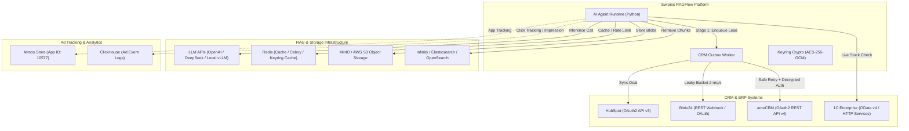

# Внешние и внутренние интеграции (Integrations Guide)

**Текущее состояние базы знаний:** актуально на **15 октября 2026 года**  
**Базовая ветка:** `test` (`a9b3e9f28`)  
**Базовый upstream:** `v0.27.2` (`a024bea0c`)

---

## 1. Обзор ландшафта интеграций

Платформа Swipies RAGFlow взаимодействует с широким спектром внешних систем, разделенных на четыре ключевые категории:
1. **Корпоративные CRM и ERP-системы (amoCRM, Bitrix24, 1С, HubSpot)** — подсистема синхронизации сделок и проверки складских остатков.
2. **Инфраструктура RAG и AI (LLM провайдеры, векторные БД, объектные хранилища)** — базовый стек upstream RAGFlow.
3. **Рекламные и аналитические трекеры (Swipies Ads, ClickHouse, Atmos store 10577)** — подсистема монетизации и борьбы с фродом.
4. **Служебные шины данных и очереди (Redis, MySQL, Outbox Worker)** — транспорт внутренних сообщений и задач.



---

## 2. Интеграция с CRM и ERP-системами

Все учетные данные CRM шифруются с помощью AES-256-GCM ([ADR-001](decisions/ADR-001-connector-cryptography-fail-closed.md), [ADR-002](decisions/ADR-002-crm-subsystem-isolation.md)). Ключи извлекаются из БД и расшифровываются исключительно в изолированном контексте выполнения сетевого запроса.

### 2.1. amoCRM (v4 REST API)
- **Файл адаптера:** [api/crm/adapters/amocrm_adapter.py](../../api/crm/adapters/amocrm_adapter.py)
- **Тип авторизации:** OAuth 2.0 (Authorization Code Grant с авто-обновлением по `refresh_token`).
- **Схема защиты:**
  - Токены хранятся в зашифрованном поле `TenantCRMConfig.encrypted_credentials`.
  - При возникновении ошибки `401 Unauthorized` адаптер выполняет автоматический refresh токена с проверкой версионности `token_version` (предотвращение race condition при параллельных запросах).
- **Спецификация вызовов:**
  - Создание сделки с контактом: `POST https://{subdomain}.amocrm.ru/api/v4/leads/complex`
  - Добавление примечания: `POST https://{subdomain}.amocrm.ru/api/v4/leads/{id}/notes`
- **Лимиты:** До 7 запросов в секунду на аккаунт. Реализована задержка при получении HTTP 429.

### 2.2. Bitrix24 (REST API / Webhook)
- **Файл адаптера:** [api/crm/adapters/bitrix24_adapter.py](../../api/crm/adapters/bitrix24_adapter.py)
- **Тип авторизации:**
  - Входящий вебхук: `https://{domain}/rest/{user_id}/{webhook_token}/`
  - OAuth 2.0 приложение (для корпоративных тарифов).
- **Ограничение частоты (Rate Limiting):**
  - Bitrix24 жестко ограничивает частоту 2 запросами в секунду на облачный портал.
  - В адаптере встроен потокобезопасный алгоритм **Leaky Bucket** на уровне каждого тенанта.
- **Маскирование в логах:**
  - URL вебхука содержит секретный токен в пути запроса. Все логи системы принудительно заменяют токен на `[REDACTED_WEBHOOK]`.
- **Спецификация вызовов:**
  - Создание лида: `POST .../crm.lead.add.json`
  - Создание сделки: `POST .../crm.deal.add.json`
  - Привязка контакта: `POST .../crm.contact.add.json`

### 2.3. 1С:Предприятие (OData v4 / HTTP Services)
- **Файлы:**
  - Адаптер: [api/crm/adapters/onec_adapter.py](../../api/crm/adapters/onec_adapter.py)
  - Агентский инструмент: [agent/tools/crm_stock_check.py](../../agent/tools/crm_stock_check.py)
- **Тип авторизации:** HTTP Basic Auth (логин/пароль) либо заголовок API-Key.
- **Принцип работы (Read-Only Live Query):**
  - AI-агент в реальном времени диалога обращается к 1С для проверки доступности товара на складе:
    ```http
    GET /hs/ragflow/v1/stock?sku={sku}&warehouse={id} HTTP/1.1
    Host: 1c.enterprise.local
    Authorization: Basic [REDACTED]
    Accept: application/json
    ```
- **Защита от сбоев 1С (Fault Tolerance):**
  - **Таймаут:** Строго 3.0 секунды.
  - **Circuit Breaker:** При 3 последовательных ошибках (или таймаутах) коннектор размыкает цепь на 30 секунд.
  - **Fallback:** Если 1С недоступна, агент возвращает клиенту корректное сообщение: *"Информация об остатках временно уточняется, наш менеджер проверит наличие и свяжется с вами"*, а лид передается в CRM Outbox.

---

## 3. Инфраструктура RAG и хранилищ

Базовые интеграции upstream RAGFlow v0.27.2:

### 3.1. Векторные движки (Vector Engines)
- **Infinity (Рекомендуемый по умолчанию):** Встроенная гибридная векторная база данных с поддержкой разреженных векторов (BM25) и плотных векторов (Dense Embedding). Сетевой порт: `23817`.
- **Elasticsearch (v8.x):** Полнотекстовый и векторный поиск.
- **OpenSearch:** Альтернатива Elasticsearch для AWS-окружений.

### 3.2. Объектное хранилище документов (MinIO / S3)
- **Назначение:** Хранение оригиналов загруженных PDF, DOCX, XLSX файлов, а также нарезанных изображений таблиц и графиков.
- **Конфигурация:**
  - Порт MinIO: `9000` (API), `9001` (Web Console).
  - Настройка через `MINIO_ENDPOINT`, `MINIO_ACCESS_KEY`, `MINIO_SECRET_KEY`.

### 3.3. Реляционная БД и Очереди (MySQL & Redis)
- **MySQL 8.0:** Хранение пользователей, тенантов, баз знаний, истории диалогов, конфигураций CRM и очередей Outbox.
- **Redis 7.0:** Кэширование сессий, очередь задач асинхронного парсинга файлов (Celery / Task-Workers), распределенная блокировка.

---

## 4. Рекламные трекеры и внешняя аналитика

### 4.1. Atmos Store Integration
- **Идентификатор приложения (App ID):** `10577`
- **Назначение:** Атрибуция установок мобильного приложения и переходов из рекламных баннеров Swipies.
- **Спецификация:** Серверный постбэк (S2S Postback) с передачей параметров клика (`click_id`, `sub_id`, `device_fingerprint`).

### 4.2. Swipies ClickHouse Analytics
- **Назначение:** Хранение сырых логов показов рекламы, кликов и скоринга фрода в реальном времени.
- **Схема интеграции:** Высокопроизводительная пакетная вставка (Batch Insert) из фонового воркера.

---

## 5. Модели AI (LLM & Embeddings)

Платформа поддерживает интеграцию со всеми основными провайдерами через унифицированный шлюз [api/db/services/llm_service.py](../../api/db/services/llm_service.py):
- **Облачные API:** OpenAI (GPT-4o, o3-mini), Anthropic (Claude 3.5 Sonnet), DeepSeek (V3, R1), Google Gemini 2.0.
- **Локальные инференс-серверы:** vLLM, Ollama, Xinference, LMDeploy (поддержка протокола OpenAI Compatible).
- **Rerankers:** BAAI/bge-reranker-large, Jina Reranker v2.
