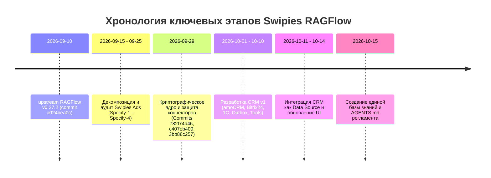

# История выполненных работ (Work History)

> **Статус документа:** Актуален  
> **Дата последней проверки:** 2026-10-15  
> **Основная ветка:** `test`

В данном документе приведена подтверждённая хронология инженерных работ на основе Git-лога репозитория.

---

## 1. Хронологическая шкала ключевых вех

---

## 2. Подтверждённые этапы и коммиты

### Этап 1: Базовый релиз upstream и слияние (10 сентября 2026)
* **Коммит:** [`a024bea0c`](https://github.com/infiniflow/ragflow/commit/a024bea0cd93f39e6652a42bf84dd20c55bc560b) (*Docs: v0.27.2 release notes*)
* **Суть:** Фиксация базовой версии движка RAGFlow 0.27.2. Включает базовый DeepDoc, поддержку гибридного поиска и визуальный редактор Canvas.

### Этап 2: Рефакторинг и аудит безопасности Swipies Ads (15–25 сентября 2026)
* **Коммиты:** [`afbae71d9`](https://github.com/Sardorr555/swipies__ai_/commit/afbae71d9) — [`c4d9f3e3c`](https://github.com/Sardorr555/swipies__ai_/commit/c4d9f3e3c)
* **Автор:** `Sardor <albakiev.sardorbek@gmail.com>`
* **Выполненные задачи:**
  - Устранение рантайм DDL, PII-хардкодов и race conditions в балансе рекламодателей (`afbae71d9`).
  - Исправление дублирования URL-префиксов на 29 эндпоинтах Ad Engine (`bfc91994a`).
  - Декомпозиция монолитного UI на 14 независимых модульных вкладок под `web/src/pages/ads/tabs/` (`OverviewTab`, `CampaignsTab`, `AudiencesTab`, `AnalyticsTab`, `AttributionTab`, `FraudTab`, `BillingTab`, `TeamTab` и др.).
  - Устранение крашей `TypeError toFixed of undefined` с помощью утилит безопасного форматирования (`95d1e2fb3`).

### Этап 3: Защита учётных данных и криптоядро (29 сентября 2026)
* **Коммиты:**
  - [`782f74d46`](https://github.com/Sardorr555/swipies__ai_/commit/782f74d46c21915d76bb7eb0ee529442b896f4e1): `feat(crypto): AES-256-GCM encryption, RFC 5869 HKDF, keyring, URL sanitizer`.
  - [`c407eb409`](https://github.com/Sardorr555/swipies__ai_/commit/c407eb409d0ccd6629dbb12694223e08c9643206): `fix(security): protect connector credentials at rest and in transit (Part A)`.
  - [`3bb88c257`](https://github.com/Sardorr555/swipies__ai_/commit/3bb88c25798f771cd8174f8196c2f65a50f5e49d): `feat(security): connector credentials migration CLI with dry-run, reverse, rotation and test suite (Part B)`.
* **Выполненные задачи:**
  - Разработано криптографическое ядро на базе AES-256-GCM в `api/utils/key_crypto.py` и `internal/utility/crypto.go`.
  - Внедрена политика fail-closed: ключи короче 32 символов или дефолтные тестовые строки жестко вызывают ошибку при попытке шифрования.
  - Настроено автоматическое маскирование паролей и API-токенов коннекторов в виде `********` в REST API.
  - Создан CLI-инструмент миграции существующих БД `api/scripts/migrate_connector_credentials.py`.
  - Написан проверочный тестовый набор из 15 тестов в `test/test_connector_security.py` с доказанной защитой от утечек через мутационное тестирование.

### Этап 4: Разработка и интеграция CRM v1 (1–14 октября 2026)
* **Коммиты:**
  - [`4612f87b4`](https://github.com/Sardorr555/swipies__ai_/commit/4612f87b4): Документирование спецификации `specs/003-crm-v1-integration/spec.md`.
  - [`b6edf7aad`](https://github.com/Sardorr555/swipies__ai_/commit/b6edf7aad): Реализация `api/db/crm_models.py`, `api/crm/base.py`, `license_gate.py`.
  - [`473097267`](https://github.com/Sardorr555/swipies__ai_/commit/473097267): Адаптер amoCRM / Kommo с распределённым локом обновления токена и версионированием `token_version`.
  - [`02f6461d7`](https://github.com/Sardorr555/swipies__ai_/commit/02f6461d7): Адаптер Bitrix24 (Cloud & On-premise) с Leaky Bucket лимитером 2 req/s и маскированием пути вебхука.
  - [`7459375eb`](https://github.com/Sardorr555/swipies__ai_/commit/7459375eb): Инструмент агента `create_incoming_lead.py` и Outbox воркер `rag/svr/crm_outbox_worker.py`.
  - [`b895a9621`](https://github.com/Sardorr555/swipies__ai_/commit/b895a9621): Инструмент онлайн-проверки остатков 1С:Предприятие `check_stock.py`.
  - [`d86f96b8e`](https://github.com/Sardorr555/swipies__ai_/commit/d86f96b8e): Коннекторы данных CRM в `common/data_source/` (amoCRM, Bitrix24, HubSpot, 1C).
  - [`37c44bcef`], [`c52f61ac0`]: Инструмент `query_crm_records.py` (Text-to-SQL с агрегациями и кэшированием).
  - [`e83d9a82a`], [`6822b3676`]: Обновление пользовательского интерфейса подключения Data Source в React (`web/src/pages/user-setting/data-source/constant/index.tsx`).
  - [`a8f21ea63`], [`6a35606d0`]: Глубокое тестирование коннекторов, валидация URL и fallback-режимов соединения.

### Этап 5: Создание единой базы знаний (15 октября 2026)
* **Задачи:**
  - Создание входного руководства `AGENTS.md`.
  - Построение структуры документации в `docs/knowledge-base/`.
  - Формализация реестра решений (ADR) и шаблонов совместной работы.
  - Добавление чек-листа документации в `.github/pull_request_template.md`.
